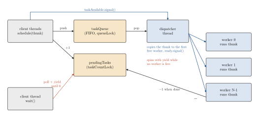
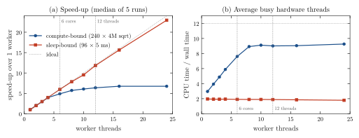

<div align="center">

# A Dispatcher-Based Thread Pool in C++

**Santiago Groba Alonso**

Universidad de San Andrés · *I304 Computer Architecture and Operating Systems* · First semester 2025 · Assignment 5

[](#reproducing-the-results)
[](#reproducing-the-results)

<picture>
  <source media="(prefers-color-scheme: dark)" srcset="docs/figures/trajectory-dark.svg">
  
</picture>

</div>

> **Abstract.** A thread pool runs many small tasks on a fixed set of threads so that thread creation is paid once. The assignment fixes the interface (`schedule`, `wait`, destructor) and the architecture: a dispatcher thread takes tasks from a FIFO queue and hands each one to a specific idle worker. This implementation coordinates the queue, the dispatcher and the workers with the course's semaphore class and passes every case of the course tests (`tptest`: 1 000 tasks on 12 workers; `tpcustomtest`: five scenarios), all terminating without deadlocks. A benchmark written for this README, which uses the pool unchanged, measures a 22.9× speed-up with 24 workers on sleep-bound tasks and 6.4× with 12 workers on compute-bound tasks on a 6-core, 12-thread CPU. It also shows the cost of two polling loops: about two hardware threads stay busy whenever the pool has work in flight, even when every task is asleep.

---

## 1. Problem

The class to implement is

```cpp
class ThreadPool {
  public:
    ThreadPool(size_t numThreads);
    void schedule(const std::function<void(void)>& thunk);  // enqueue, notify the dispatcher, return at once
    void wait();                                             // block until every scheduled thunk has finished
    ~ThreadPool();                                           // wait, then release every resource
};
```

The constructor starts one dispatcher thread and `numThreads` worker threads. The dispatcher sleeps until `schedule` signals new work, then waits for an idle worker, marks it busy, gives it a copy of the next thunk and signals it; a worker sleeps until signalled, runs its thunk and becomes available again. `schedule` and `wait` must be thread-safe and `wait` must be callable repeatedly. Passing all cases in `tptest.cc` and `tpcustomtest.cc` without errors or deadlocks is required.

## 2. Methods

<p align="center"></p>

**Figure 1.** Data flow in `src/thread-pool.cc`. Blue arrows are semaphore signals; the two loops marked in red wait by polling with `this_thread::yield()`.

| Component | Choice |
|---|---|
| Task queue | `std::queue<std::function<void()>>` protected by a binary `Semaphore` (`queueLock`) |
| Wake-up of the dispatcher | Counting semaphore `taskAvailable`, signalled once per `schedule` |
| Worker state | `worker_t` holds the `std::thread`, the assigned thunk, `available`/`busy` flags and three semaphores: `ready` (work assigned), `done` and `statusLock` (protects the flags) |
| Assignment | The dispatcher scans the workers in order and gives the thunk to the first available one; if none is free it yields and scans again |
| Completion | `pendingTasks` is incremented by `schedule` and decremented after a thunk returns; `wait()` polls it until it reaches zero, and a `waitSem` serialises concurrent `wait()` calls |
| Errors | `schedule` throws on an empty thunk or once destruction has started; exceptions thrown by a thunk are caught so the worker survives; a `wait()` issued from inside a thunk is detected with a `thread_local` flag and blocks that worker instead of waiting for itself |
| Shutdown | The destructor calls `wait()`, sets `done`, signals the dispatcher and every worker, joins all threads and deletes the per-worker semaphores |

The benchmark (`docs/figures/bench.cc`) schedules independent thunks and times one `wait()` plus the destructor, for 1 to 24 workers, 5 runs each:
*compute-bound*, 240 tasks each running a 4-million-iteration floating-point loop, and *sleep-bound*, 96 tasks each sleeping 5 ms (a stand-in for blocking I/O). CPU time is the process's user plus system time from `getrusage`.

## 3. Results

### 3.1 Course tests

**Table 1.** Course tests, built with `g++ -std=c++11 -Wall -pthread -g` as in the provided Makefile.

| Program | What it checks | Result | Wall time |
|---|---|---|---:|
| `threadpool` (`main.cc`) | Sum of a 15-element vector split over 3 workers | prints 219 (correct) | — |
| `tptest` | 1 000 thunks sleeping 0, 10 or 20 ms on 12 workers | 1 000 "started" and 1 000 "finished" lines, exit 0 | 0.85 s |
| `tpcustomtest --single-thread-no-wait` | Destructor with a task scheduled and no `wait()` | exit 0 | 1.00 s |
| `tpcustomtest --single-thread-single-wait` | Destructor waits for a 1 s task | exit 0 | 1.00 s |
| `tpcustomtest --no-threads-double-wait` | Two `wait()` calls on an idle pool | exit 0 | 0.00 s |
| `tpcustomtest --reuse-thread-pool` | 16 tasks, `wait()`, one more task, `wait()` | 17 lines, exit 0 | 1.20 s |
| `tpcustomtest --s` | 10 tasks on 4 workers | 20 lines, exit 0 | 0.03 s |
| `tpcustomtest --all` | All of the above in sequence | 44 lines, exit 0 | 3.23 s |

The `tptest` time is close to the ideal: the thunks sleep 9.99 s in total, which spread over 12 workers is 0.83 s.

### 3.2 Scaling

<p align="center"></p>

**Figure 2.** (a) Speed-up over one worker. Sleep-bound tasks follow the ideal line up to 24 workers; compute-bound tasks scale linearly up to 4 workers and level off once the 6 physical cores are taken. (b) CPU time divided by wall time. The sleep-bound curve sits at about 2 for every worker count: that is the dispatcher and the thread in `wait()` polling, since the tasks themselves use no CPU. In the compute-bound case one worker already keeps 3 hardware threads busy.

**Table 2.** Medians of 5 runs (`docs/figures/bench.csv`). Machine: AMD Ryzen 5 5600 (6 cores, 12 hardware threads), Linux 7.2.9 (Fedora 45), GCC 16.2.1 with `-O2`.

| Workers | Compute-bound: wall [s] | speed-up | busy threads | Sleep-bound: wall [ms] | speed-up | busy threads |
|---:|---:|---:|---:|---:|---:|---:|
| 1 | 2.655 | 1.00 | 3.0 | 486 | 1.00 | 2.0 |
| 2 | 1.317 | 2.02 | 3.9 | 243 | 2.00 | 1.9 |
| 4 | 0.669 | 3.97 | 5.9 | 122 | 3.99 | 1.9 |
| 6 | 0.543 | 4.89 | 7.6 | 81 | 5.97 | 1.9 |
| 8 | 0.464 | 5.72 | 8.9 | 62 | 7.87 | 1.9 |
| 12 | 0.417 | 6.37 | 9.0 | 41 | 11.83 | 1.9 |
| 16 | 0.394 | 6.75 | 9.0 | 31 | 15.63 | 1.9 |
| 24 | 0.394 | 6.74 | 9.3 | 21 | 22.93 | 1.8 |

The machine was shared with other jobs while measuring (load average 4.6 when this run started), which mostly affects the compute-bound curve above 6 workers. Over three complete runs, its speed-up at 12 workers was 6.4, 5.3 and 6.1, while the sleep-bound speed-up at 12 workers was 11.8 in all three.

## 4. Takeaways

- The dispatcher design gives a clean hand-off (one semaphore per worker, so the dispatcher decides exactly who runs what), at the price of an extra thread on the critical path of every task.
- Polling with `yield` is correct but not free: `wait()` and the dispatcher's search for an idle worker each occupy a hardware thread for as long as tasks are in flight. Blocking on a semaphore signalled when `pendingTasks` reaches zero, and on a counting semaphore of idle workers, would return those two threads to the tasks.
- Whether more workers help depends on what the tasks wait for: latency-bound work scales with the number of workers, compute-bound work with the number of cores.

## Reproducing the results

```bash
cd src
make && ./threadpool                                   # main.cc demo
g++ -std=c++11 -Wall -pthread -g -o tptest thread-pool.cc Semaphore.cc tptest.cc && ./tptest
g++ -std=c++11 -Wall -pthread -g -o tpcustomtest thread-pool.cc Semaphore.cc tpcustomtest.cc
./tpcustomtest --all                                   # or one flag: --single-thread-no-wait, --single-thread-single-wait,
                                                       #   --no-threads-double-wait, --reuse-thread-pool, --s
cd ..
g++ -std=c++11 -O2 -pthread -Isrc docs/figures/bench.cc src/thread-pool.cc src/Semaphore.cc -o bench
./bench > docs/figures/bench.csv                       # about a minute; replaces the data behind Figure 2
python docs/figures/make_figures.py                    # Figures 1–2 and Table 2
```

The provided Makefile only builds `main.cc`; the two `g++` lines above build the test programs without editing it.

| File | Content | Origin |
|---|---|---|
| `src/thread-pool.cc` | The pool: constructor, `schedule`, `wait`, dispatcher, workers, destructor | Santiago (on the course skeleton) |
| `src/thread-pool.h` | Class declaration; `worker_t` fields and private members completed | Course skeleton + Santiago |
| `src/Semaphore.h`, `src/Semaphore.cc` | Semaphore built on `mutex` + `condition_variable_any` | Course |
| `src/main.cc`, `src/tptest.cc`, `src/tpcustomtest.cc`, `src/Makefile` | Demo, tests and build | Course |
| `docs/figures/bench.cc`, `docs/figures/bench.csv` | Benchmark and its raw output | This README |
| `docs/figures/make_figures.py` | Figure script | This README |

## Acknowledgements

Assignment, semaphore class and tests by the I304 teaching staff at UdeSA.

## Citation

```bibtex
@misc{groba2025threadpool,
  author       = {Groba Alonso, Santiago},
  title        = {A Dispatcher-Based Thread Pool in {C++}},
  year         = {2025},
  howpublished = {Universidad de San Andr{\'e}s, I304 Computer Architecture and Operating Systems},
  url          = {https://github.com/Santi2065/cpp-thread-pool}
}
```
